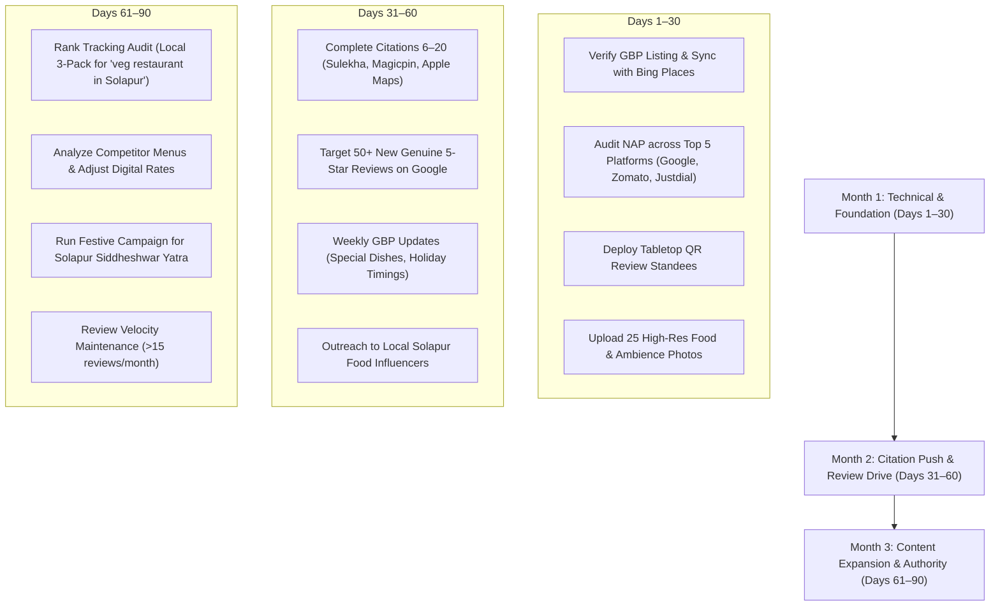

# Local SEO & Off-Page Dominance Checklist — Amol Veg Resto (Solapur)

**Target Market:** Solapur City & District, Maharashtra, India  
**Target Entities:** "Amol Veg", "Amol Veg Resto", "Amol Veg Restaurant Solapur", "pure veg restaurant in Solapur", "best family restaurant Solapur"  
**Verified Google Maps Entity:** `AMOL VEG RESTO` (CID: `11262657754378175886`)  
**Direct Google Review Link:** `https://maps.app.goo.gl/hMPnkZ2aZg2Pmqn76`

---

## 1. Google Business Profile (GBP) Optimization Blueprint

To rank in the **Google Maps Local 3-Pack** for high-volume searches ("veg restaurant in Solapur", "pure veg hotel near me", "best veg thali Solapur"), the Google Business Profile must be 100% complete and actively maintained.

### A. Core Profile Configuration
- **Business Title:** `AMOL VEG RESTO`  
  *(Note: Do not spam extra keywords in the title as per Google Business Profile guidelines to avoid suspension risk).*
- **Primary Category:** `Vegetarian restaurant` (Essential)
- **Secondary Categories:**
  - `South Indian restaurant`
  - `Family restaurant`
  - `Indian restaurant`
  - `Breakfast restaurant`
  - `Delivery restaurant`
- **Address (Exact Match):**  
  `Gala No 2, Plot 16/1, Markandeya Yantramag Sahakari Sanstha, Karnik Nagar Road, Near Uphar Bakery / Ashok Chowk, Sakhar Peth, Solapur, Maharashtra 413006`
- **Service Area:** Solapur (Sakhar Peth, Ashok Chowk, Navi Peth, Budhwar Peth, Jule Solapur, Solapur Railway Station, Siddheshwar Lake area).
- **Opening Hours:** `11:00 AM – 11:30 PM` (Monday – Sunday)
- **Phone:** `+91 72496 64983` (Primary), `+91 81491 73027` (Secondary)
- **Website URL:** `https://amolvegresto.in/`
- **Menu Link:** `https://amolvegresto.in/menu/`
- **Appointment / Reservation Link:** `https://amolvegresto.in/contact`

### B. Crucial Business Attributes
Turn on all relevant attributes in GBP dashboard:
- **Dining options:** Dine-in, Takeaway, Parcel service, Delivery.
- **Offerings:** Vegetarian options, Vegan options, Healthy options, Coffee, Quick bites, Small plates, Kids' menu.
- **Crowd:** Family friendly, Groups, Good for kids.
- **Atmosphere:** Casual, Cozy, Clean & Hygienic.
- **Amenities:** Air-conditioned dining hall, Restrooms.
- **Payments:** Cash, Google Pay, PhonePe, Paytm, BHIM UPI, Debit cards, Credit cards.

### C. Visual Asset Upload Strategy (Target: 50+ Photos)
Google's algorithm prioritizes listings that regularly upload high-resolution, user-relevant images:
1. **Exterior & Signage (3 photos):** Bright daytime storefront showing "AMOL VEG RESTO" board, parking area, and street landmark (near Uphar Bakery).
2. **Interior & Family Seating (6 photos):** Clean AC dining room, booth seating, lighting, and table setups.
3. **Hero Dishes (15+ photos):** Crisp Masala Dosa, Special Solapuri Thali, Paneer Butter Masala, Wok Fried Rice, Veg Grill Sandwich, and steaming Brass Filter Coffee.
4. **Kitchen Hygiene (4 photos):** Spotless stainless steel preparation surfaces, ritual vegetable cleaning, and modern cooking appliances.
5. **Team & Hospitality (3 photos):** Smiling staff in uniform welcoming guests.

### D. GBP Q&A Seeding (Answer Engine Optimization)
Seed these questions from a manager or trusted customer account, then answer officially from the Owner profile:
- **Q:** *Is Amol Veg Resto strictly pure vegetarian?*  
  **A (Owner):** *Yes, Amol Veg Resto is 100% pure vegetarian. We have a dedicated vegetarian kitchen and also serve Jain options prepared without onion or garlic.*
- **Q:** *What are your timings and is parking available?*  
  **A (Owner):** *We are open every day from 11:00 AM to 11:30 PM. Two-wheeler and roadside four-wheeler parking is available on Karnik Nagar Road.*
- **Q:** *Can I view the menu and prices online?*  
  **A (Owner):** *Yes, please visit our official digital menu at https://amolvegresto.in/menu/ to view all 280+ dishes with live prices.*

---

## 2. Citation & Directory Distribution (Top 20 Platforms)

Consistency across Name, Address, and Phone (NAP) is the #1 foundational signal for local search authority. Use the exact formatting below:

### Standardized NAP
| Field | Standard Entry |
| :--- | :--- |
| **Business Name** | Amol Veg Resto |
| **Address** | Gala No 2, Plot 16/1, Karnik Nagar Road, Near Ashok Chowk, Sakhar Peth, Solapur, Maharashtra 413006 |
| **Phone** | +91 72496 64983 |
| **Website** | https://amolvegresto.in |
| **Menu URL** | https://amolvegresto.in/menu/ |

### Top 20 Citation Targets

| # | Directory / Platform | Priority | Category | NAP Consistency Status |
| :--- | :--- | :--- | :--- | :--- |
| 1 | **Google Business Profile** | P0 (Critical) | Search / Maps | Verified & Linked |
| 2 | **Bing Places for Business** | P0 (Critical) | Search / Maps | Ready for Sync via GBP |
| 3 | **Apple Maps Connect** | P0 (Critical) | Mobile Navigation | Submit claim |
| 4 | **Zomato** | P0 (Critical) | Food & Dining | Restaurant Listing & Online Menu |
| 5 | **Swiggy** | P0 (Critical) | Food & Delivery | Restaurant Onboarding |
| 6 | **Justdial Solapur** | P1 (High) | Local Directory | Claim Sakhar Peth listing |
| 7 | **Tripadvisor India** | P1 (High) | Travel & Dining | Solapur Restaurant Category |
| 8 | **Magicpin** | P1 (High) | Local Food / Rewards | Dining outlet registration |
| 9 | **Sulekha Solapur** | P1 (High) | Local Classifieds | Food & Restaurant category |
| 10 | **Facebook Business Page** | P1 (High) | Social & Local Page | Configure official page + Map check-in |
| 11 | **Instagram Business Profile** | P1 (High) | Visual Social | Bio link: `amolvegresto.in/menu/` |
| 12 | **IndiaMART** | P2 (Medium) | B2B / Local Trade | Food Service provider listing |
| 13 | **AskLaila Solapur** | P2 (Medium) | Local Directory | City food directory |
| 14 | **YellowPages India** | P2 (Medium) | Business Directory | Solapur dining guide |
| 15 | **Foursquare / Swarm** | P2 (Medium) | Geolocation Database | Location beacon for third-party apps |
| 16 | **MapmyIndia (Mappls)** | P2 (Medium) | Indian Geospatial App | Local PIN 413006 mapping |
| 17 | **Solapur Online City Portal** | P2 (Medium) | Municipal / City Guide | Sakhar Peth business directory |
| 18 | **Restaurant Guru** | P2 (Medium) | Global Food Aggregator | Claim Solapur profile |
| 19 | **WhatsApp Business Catalog**| P1 (High) | Direct Messaging | Upload top 20 popular dishes with photos |
| 20 | **Cylex India** | P3 (Low) | Business Directory | Backlink & citation booster |

---

## 3. White-Hat Review Velocity & Management System

Online reviews are both a direct ranking factor for Google Maps and the highest conversion trigger for dining foot traffic.

### A. Frictionless Review Flow
- Place acrylic standees on all dining tables featuring a prominent QR code linked directly to `https://maps.app.goo.gl/hMPnkZ2aZg2Pmqn76`.
- Direct callout on digital menu: The top bar already features a prominent `"Review Us"` button leading to the Google Maps review dialog.
- Staff training: When guests express appreciation ("Food was great!"), servers politely say: *"Thank you so much! If you have a minute, please scan the table QR code to leave a quick Google review — it helps our family kitchen immensely."*

### B. Review Response Protocols (100% Response Rate Target)
1. **Positive Review Response Template (Insert local keyword naturally):**  
   *"Thank you so much [Name]! We are thrilled you enjoyed our [Dish Name, e.g., crisp Masala Dosa / Special Solapuri Thali]. Serving fresh, authentic pure vegetarian food in Sakhar Peth is our passion. Looking forward to welcoming you and your family back to Amol Veg Resto soon!"*
2. **Constructive / Negative Review Response Template (Resolution within 24 hours):**  
   *"Dear [Name], thank you for your candid feedback. We sincerely apologize that your experience did not meet our usual high standard. Hygiene, quality, and quick service are our top priorities. Please contact our owner directly at +91 72496 64983 so we can understand what happened and make it right for you on your next visit."*

---

## 4. 30 / 60 / 90-Day Local Dominance Roadmap

