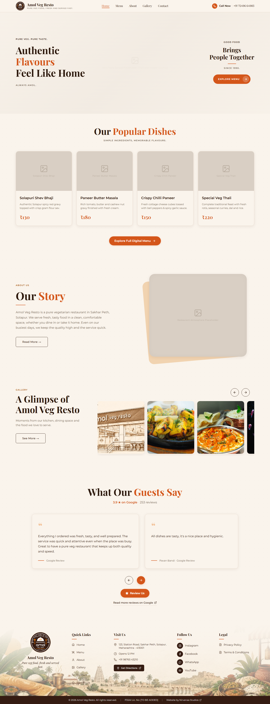
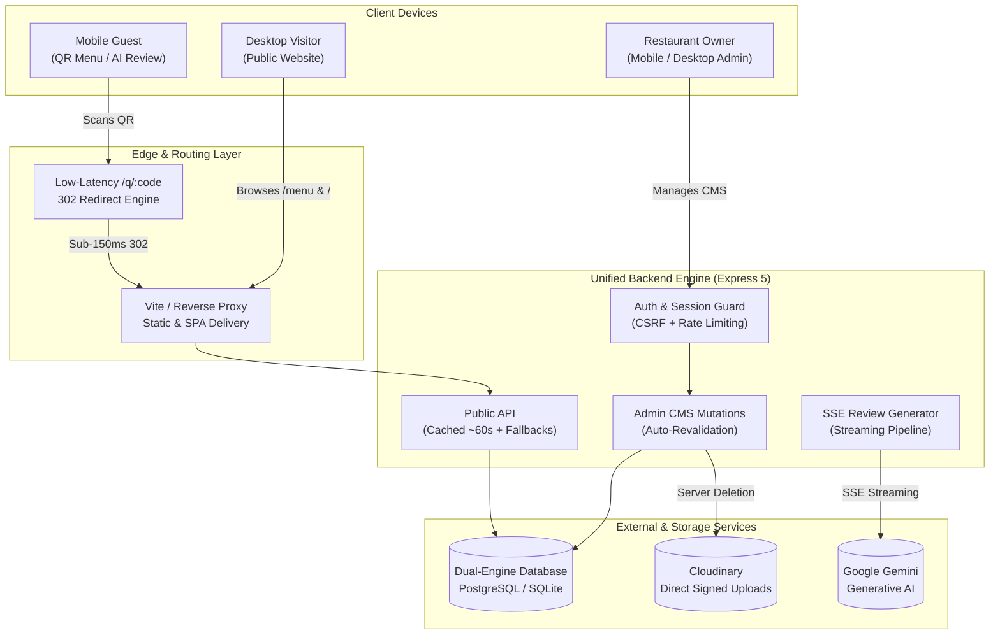

# Amol Veg Resto — Modern Hospitality Platform

> **Pure Vegetarian Heritage Meets Next-Generation Headless Dining Architecture**

---

## 🌟 Standout Technical Highlights

- **Dual-Engine Dynamic Dining**: Seamless synchronization across Public Main and Special Dining menus with automated percentage markup, rounding controls, and manual price overrides.
- **Zero-Latency Dynamic QR Engine**: Sub-150ms 302 redirect engine with non-blocking scan analytics, fingerprint deduplication, bot filtering, and print-ready A5 PDF generation.
- **AI-Powered Customer Review Booster**: Interactive multi-star rating assistant with zero-delay local phrase generation and real-time Server-Sent Events (SSE) streaming via Google Gemini.
- **Hardened Owner-Only Admin Panel**: Mobile-first responsive CMS with Argon2id/Bcrypt authentication, httpOnly SameSite=Strict sessions, CSRF token validation, and CSP headers.
- **High-Performance Resilient Delivery**: Client-side edge caching (~60s TTL), instant fallback to bundled seed snapshots, and direct browser-to-cloud signed media uploads.

---

## 🏗️ System Architecture

---

## 🛠️ Technology Stack

| Layer | Technology | Rationale |
|---|---|---|
| **Frontend Framework** | React 18 + TypeScript | Type-safe declarative UI with optimal re-rendering performance |
| **Styling & Design** | Pure CSS Variables & Tokens | Zero runtime overhead, authentic warm paper aesthetic |
| **Bundler & Dev Server** | Vite 6 | Sub-second Hot Module Replacement and optimized chunking |
| **Application Server** | Node.js + Express 5 | High-throughput async I/O with native SSE and cookie parsing |
| **Database Architecture** | PostgreSQL / SQLite (Dual-Engine) | Zero-friction local development with zero-code Postgres production switch |
| **Media Pipeline** | Cloudinary Direct API | Direct client-to-cloud signed uploads with automated image optimization |
| **AI Intelligence** | Google Gemini API | Low-latency natural language review synthesis and tone refinement |
| **E2E Test Engine** | Playwright Chromium | Deterministic, headless visual regression and critical-path validation |

---

## 📍 About Amol Veg Resto

**Amol Veg Resto** is a beloved pure vegetarian restaurant in Sakhar Peth, Solapur, Maharashtra. Renowned for authentic Maharashtrian specialties, tandoor delicacies, and Solapuri Shev Bhaji, this project honors that rich culinary heritage through modern, bespoke digital craftsmanship.
